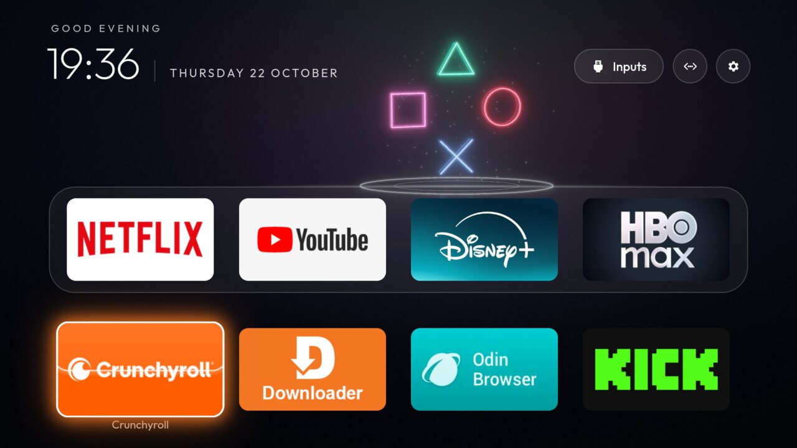
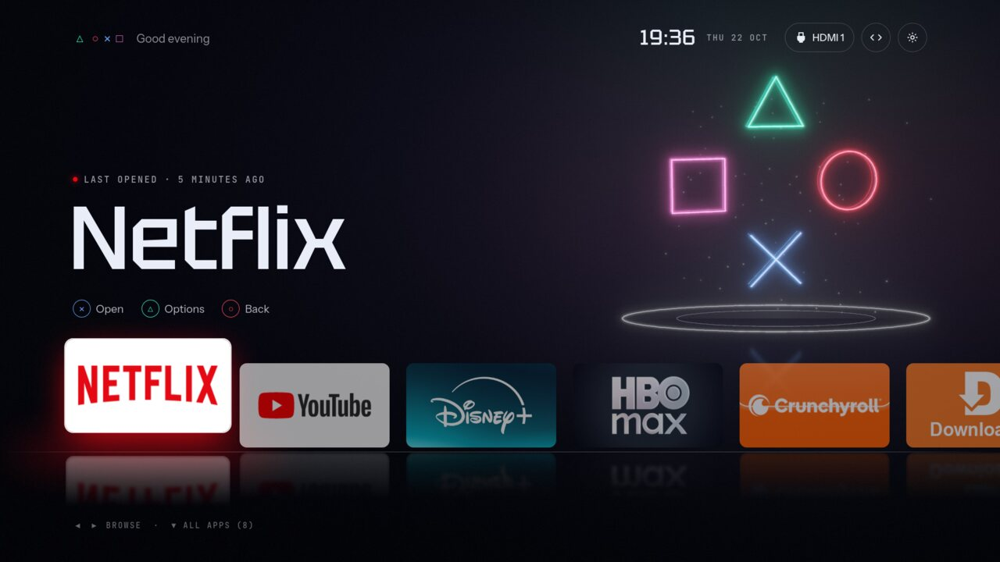
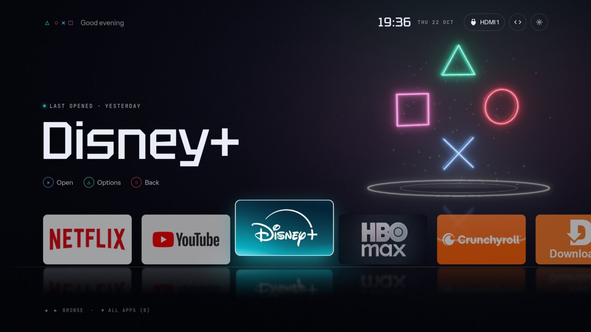
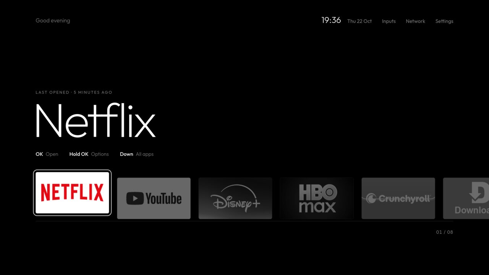
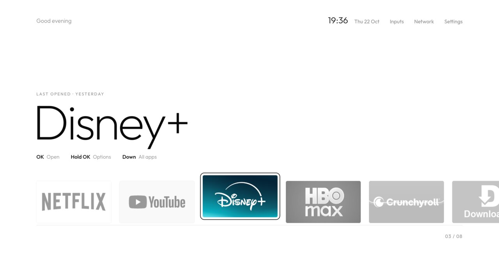
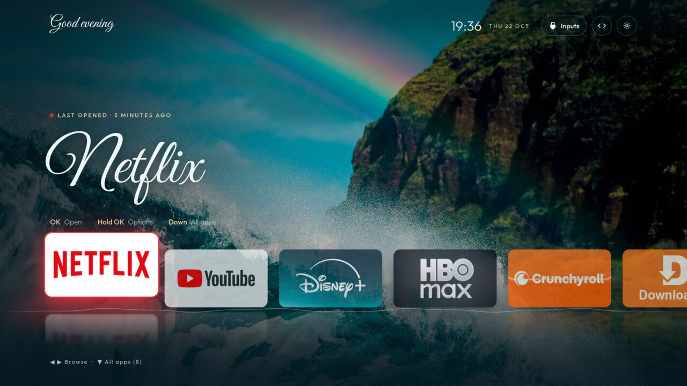
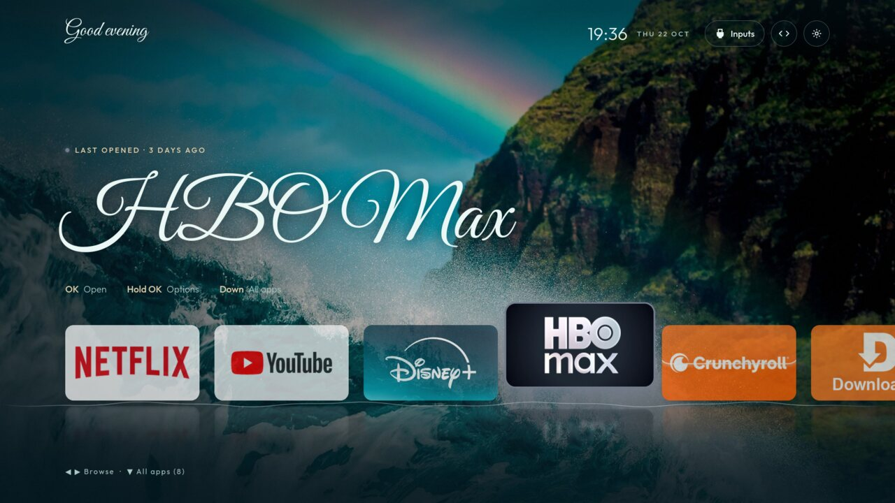

# Hard Light: turning the cleanyourtv launcher into a one-row "rail" Home

This fork reshapes the cleanyourtv launcher (`com.gathin.tvhome`) into **Hard Light**, a console-style Home
screen. There is one row of apps standing on a horizon line, a big app name in a display typeface, a compact
top rail and control hints. It ships three themes for that layout: **Hard Light** (neon face-button symbols
on a cold void), **Mono** in dark and light, and **Ocean** (a wave photo, a script typeface, and focus
shadows in each app's own colour).

This guide says, in order, what to change in `launcher/` to get there. Each section has a goal, the files and
methods it touches, the steps, and how to check the result. Nothing here is implemented yet: the mockups and
themes in this folder are the target.

> Line numbers refer to upstream `main` at the time of writing (launcher `versionName 2.6`). Method names are
> given too, so you can find the spot when lines drift. Paths are relative to `launcher/app/src/main/` unless
> they start with `launcher/`, `tools/`, `tests/` or `docs/`.

## Contents

0. [What you are building](#0-what-you-are-building)
1. [Fork and branch](#1-fork-and-branch)
2. [A separate app identity](#2-a-separate-app-identity)
3. [Baseline: build, tests, size budget](#3-baseline-build-tests-size-budget)
4. [Adding config keys](#4-adding-config-keys)
5. [The display typeface](#5-the-display-typeface)
6. [Colours and light mode](#6-colours-and-light-mode)
7. [The top rail](#7-the-top-rail)
8. [The hero block](#8-the-hero-block)
9. [The rail: one horizontal row](#9-the-rail-one-horizontal-row)
10. [Tile focus: rise, dim, greyscale](#10-tile-focus-rise-dim-greyscale)
11. [Horizon, reflection, under-glow](#11-horizon-reflection-under-glow)
12. [Focus styles: outline and halo](#12-focus-styles-outline-and-halo)
13. [A Layout row in Launcher settings](#13-a-layout-row-in-launcher-settings)
14. [The themes](#14-the-themes)
15. [Performance budget](#15-performance-budget)
16. [Verification on a real TV](#16-verification-on-a-real-tv)
17. [Rollback](#17-rollback)
18. [Publishing](#18-publishing)

[Appendix A: file map](#appendix-a-file-map) · [Appendix B: new keys](#appendix-b-new-keys)

---

## 0. What you are building

| Today (stock launcher, classic dock) | Hard Light (rail) |
|---|---|
|  |  |

| Hard Light, focus moved | Mono Dark | Mono Light |
|---|---|---|
|  |  |  |

| Ocean | Ocean, focus moved |
|---|---|
|  |  |

Open [`mockups/index.html`](mockups/index.html) in a browser to move the focus with the arrow keys (keys 1–6
switch mockups). The mockups are HTML, not screenshots from a TV. The app banners in them were cropped from a
real Home screen only to illustrate the layout.

**The layout (1920×1080 reference):**

```
  △○✕□  Good evening                          19:36  THU 22 OCT  [Inputs] (<>) (⚙)   ← top rail, y≈44–100
                                                            △
                                                       □         ○      ← wallpaper (Hard Light only)
  ● LAST OPENED · 5 MINUTES AGO                             ✕
  Netflix                                               ═══════════
  (✕) Open   (△) Options   (○) Back                                     ← hints, y≈576
 ┌────────┐
 │NETFLIX │ [YouTube] [Disney+] [HBO Max] [Crunchyroll] [Downl…        ← rail, tiles 288×162 px
 └────────┘─────────────────────────────────────────────────────────   ← horizon line, y≈868
   ░reflection░  ░░░░░░░  ░░░░░░░                                       ← reflections, fading
  ◀ ▶ BROWSE · ▼ ALL APPS (8)
```

**What stays the same.** No `INTERNET` permission, `minSdk` 26, no new dependencies. It still runs on 1 GB
TVs, under the 480 KB APK gate. The classic layout stays the default, and every new key defaults to today's
behaviour. That keeps the fork easy to rebase on upstream, and lets the original look be one setting away.

**Trademark note.** △ ○ ✕ □ in the Hard Light theme are a homage to console controllers. This fork uses no
console maker's name or logo, and its art (the wallpaper generator) is original. Don't add a vendor's logo,
name or typeface to a public fork.

---

## 1. Fork and branch

**Goal:** a fork that can follow upstream.

```bash
gh repo fork Gathin23/cleanyourtv --clone=false
git clone <your fork> cleanyourtv-hardlight && cd cleanyourtv-hardlight
git remote add upstream https://github.com/Gathin23/cleanyourtv.git
git fetch upstream && git checkout -b hardlight upstream/main
```

- Do the work on `hardlight`, and keep `main` equal to upstream.
- To pick up upstream fixes, run `git fetch upstream && git rebase upstream/main` on `hardlight`.
- Commit small, one section of this guide at a time. That keeps rebases manageable.

---

## 2. A separate app identity

**Goal:** the fork installs **next to** the original launcher, so you can switch Home back at any time.

Edit these files:

| File | Change |
|---|---|
| `launcher/app/build.gradle:11` | Change the default of `applicationId`, e.g. `getOrElse('com.example.hardlight')`. Keep `namespace 'com.gathin.tvhome'` (line 6); changing it means moving every Java file. `launcher/build-and-install.sh:44` runs `./gradlew assembleRelease` without `-PlauncherApplicationId`, so the default is what gets installed. |
| `res/values/strings.xml:3` | `app_name` from `Home` to `Hard Light`, so the TV's Home chooser can tell the two apps apart. |
| `launcher/build-and-install.sh` | Introduce `PKG=${LAUNCHER_PKG:-com.example.hardlight}` near the top. Replace the literal `com.gathin.tvhome` on lines 59, 110, 119, 120, 122, 166, 195, 196 and 201 with `$PKG`. |
| `launcher/build-and-install.ps1` | The same in its twin: lines 48, 69, 74, 78, 79, 81, 86, 97, 100 and 106. |
| `tools/theme.sh:26`, `tools/theme.ps1:20` | `PKG=${LAUNCHER_PKG:-com.example.hardlight}`. The theme folder (`/sdcard/Android/data/$PKG/files`) and the provider authority (`$PKG.theme`) follow it. |
| `tools/recovery.py:33`, `tools/trace.py:117`, `tools/trace_report.py:272`, `tools/flamechart.py:193` | Change the default package. |

**Leave these alone:**
- `Cards.java:54-55`: the `com.gathin.tvhome.category.DOCK_CARD` category and the `com.gathin.tvhome.card`
  metadata are the add-on protocol. Keep them so add-ons in `addons/` still show their cards.
- `MainActivity.java:100` (`ACTION_LAUNCHER_SETTINGS`) and `LauncherSettingsActivity.java:20`
  (`EXTRA_REORDER`) are internal action strings. They don't clash between two installed apps.
- The manifest's `ThemeProvider` authority is already `${applicationId}.theme`.

**The Home guard.** If the original launcher owns Home, `build-and-install.sh` refuses to install
(lines 50–85): `com.gathin.tvhome` is not a stock launcher it knows. That refusal is the safety net, so keep
it. Install with `STOCK_LAUNCHER=none`, which installs the fork, makes it Home with `set-home-activity`, and
disables nothing:

```bash
cd launcher && TV_HOST=<tv ip> STOCK_LAUNCHER=none ./build-and-install.sh
```

The original launcher stays enabled as a fallback (see [Rollback](#17-rollback)).

**Tests that hard-code the package:**
- `tests/test_home_guard.py:23`, `tests/test_theme_push_ownership.py` (lines 24, 37, 90, 166),
  `tests/test_launcher_min_sdk.py:24`;
- the `test_launcher_handover`, `test_recovery_record`, `test_trace*`, `test_bench_*`, `test_flamechart` and
  `test_drift_check` tests.

Update the expectations to the new default, or set `LAUNCHER_PKG` in the tests' environment.

**Check:**
- `python3 -m unittest discover -s tests` passes.
- On the TV, `cmd package list packages | grep -E 'gathin|hardlight'` shows both apps.

---

## 3. Baseline: build, tests, size budget

**Goal:** know where you start before changing anything.

```bash
python3 -m venv tools/venv && tools/venv/bin/pip install -r tools/requirements.txt
python3 -m unittest discover -s tests -v
cd launcher && ./gradlew --no-daemon testReleaseUnitTest lintRelease assembleRelease
stat -c %s app/build/outputs/apk/release/app-release.apk   # macOS: stat -f %z
```

- Write the APK size down. `.github/workflows/ci.yml:51` fails at 491,520 B (480 KB). The difference is your
  budget for the display font (section 5) and the new code.
- Lint must stay at zero errors.
- If CI runs on your fork (Actions are off by default on forks; enable them under the repo's **Actions** tab),
  it enforces the same gate.

---

## 4. Adding config keys

**Goal:** a pattern you will repeat for each of the 17 new keys in [Appendix B](#appendix-b-new-keys).

`Config.java` reads each key from `res/values/config.xml` first, then lets the theme's `config.json` override
it. Follow `show_stats` end to end. Every new key touches the same places:

1. **Field:** `final boolean showStats;` (`Config.java:123`), with a javadoc naming the key.
2. **Constructor parameter:** `private Config(...)` (`Config.java:189`), assigned in the body.
3. **Resource default:** `boolean showStats = res.getBoolean(R.bool.show_stats);` (`Config.java:331`), plus
   the `<bool name="show_stats">` entry in `res/values/config.xml`, with a comment saying what it does and
   that a theme can set it.
4. **JSON override:** `showStats = bool(json, "show_stats", showStats);` (`Config.java:401`), inside
   `if (json != null)`. Use the existing helpers:
   - `string()` (587), `bool()` (592), `integer(…, min, max)` (597) and `color()` (604);
   - `color()` accepts `#RRGGBB` and forces the result opaque.
5. **Constructor call:** pass the new argument in `new Config(...)` (`Config.java:465`), in the same order.

Enum-like keys (`layout`, `display_font`, `surface_mode`, `focus_style`, `control_hints`, `header_mark`,
`horizon_style`):
- Copy `Config.glowStyle()` (the `GLOW_RADIAL` / `GLOW_HORIZON` constants near `Config.java:181`). It is a
  static parser that returns the default for unknown strings.
- Its JVM test, `launcher/app/src/test/java/com/gathin/tvhome/GlowStyleTest.java`, is the template for a test
  of each new parser.

Colour keys (`ink_color`, `muted_color`, `highlight_color`, `hairline_color`):
- Their default is "not set" (`0`), meaning "keep today's colours".
- Read them only from JSON, the way `background_color` is (`Config.java:333`, `:403`).

Add one row per key to the Keys table in `themes/README.md`. `tests/test_theme_keys_table.py` checks that each
key appears there once.

**Check:** `./gradlew testReleaseUnitTest`. A theme with an unknown value (`"layout": "grid"`) must change
nothing.

---

## 5. The display typeface

**Goal:** `display_font: "tektur"` sets the hero name and the top-rail time in
[Tektur](https://fonts.google.com/specimen/Tektur) (SIL Open Font License). `"outfit"` keeps today's face, at
ExtraLight weight for the rail's hero name.

1. Take Tektur's TTF from the [google/fonts](https://github.com/google/fonts/tree/main/ofl/tektur)
   repository. Make a static instance at weight 500, then subset it to Latin to stay inside the size budget:
   ```bash
   fonttools varLib.instancer Tektur[wdth,wght].ttf wght=500 wdth=100 -o Tektur-Medium.ttf
   pyftsubset Tektur-Medium.ttf --unicodes="U+0020-007E,U+00A0-00FF,U+2013-2014,U+2018-201D,U+2022,U+2026" \
     --layout-features='kern,liga' --output-file=res/font/tektur_medium.ttf
   ```
   Expect about 15–25 KB. Copy the font's `OFL.txt` next to `launcher/` (for example `launcher/fonts/OFL-Tektur.txt`).
2. Add `res/font/tektur.xml`, a font-family wrapper like `outfit_medium.xml` that points at
   `@font/tektur_medium`.
3. In `res/values/fonts.xml`, add `<string name="font_display" translatable="false">@font/tektur</string>`
   next to `font_body` … `font_medium` (lines 5–9).
4. In `res/values-vi/fonts.xml`, add a `font_display` fallback (a system sans). Outfit and Tektur have no
   Vietnamese glyphs; this file already does the same for Outfit.
5. In code, get the face with `UiFont.get(context, R.string.font_display)` (`UiFont.java:15`). Apply it in
   `fillHero` (section 8) and to the top-rail clock (section 7), only when `cfg.displayFont` is `tektur`.
   Otherwise, in rail mode, use `R.string.font_extralight`.

### Great Vibes (the Ocean theme)

`display_font: "great_vibes"` uses [Great Vibes](https://fonts.google.com/specimen/Great+Vibes) (SIL Open Font
License), a script face. Set the hero name and the greeting in it; the time, date, hints and tiles keep
Outfit.

1. Take `GreatVibes-Regular.ttf` and its `OFL.txt` from
   [google/fonts](https://github.com/google/fonts/tree/main/ofl/greatvibes). It has a single weight, so no
   instancing is needed.
2. Subset it the same way. A Latin-1 subset that keeps `kern,liga,calt` (the joined script needs `calt`) is
   about 73 KB, or about 42 KB compressed in the APK. ASCII only is about 55 KB raw and 31 KB compressed.
   ```bash
   pyftsubset GreatVibes-Regular.ttf --unicodes="U+0020-007E,U+00A0-00FF,U+2013-2014,U+2018-201D,U+2022,U+2026" \
     --layout-features='kern,liga,calt' --output-file=res/font/greatvibes_regular.ttf
   ```
3. Add `res/font/greatvibes.xml` and `font_script` in `values/fonts.xml`, with a system fallback in
   `values-vi/fonts.xml`.
4. In `fillHero` and `updateGreeting` (`MainActivity.java:2213`), use it when `cfg.displayFont` is
   `great_vibes`. A script face is taller than Outfit: give the name about 20% more line height and leave
   about 40dp between the eyebrow and the name, or the capital swashes run into the eyebrow (mockup F does
   this).
5. Show the greeting in sentence case ("Good evening"). Script capitals in all caps are unreadable.

**Both fonts together** cost about 60 KB of the budget from section 3. If that doesn't fit, ship only the
fonts your themes use.

**Check:** the APK grows by the font's size and no more. Lint has no `MissingTranslation` errors.

---

## 6. Colours and light mode

**Goal:** `surface_mode: "light"` plus the ink colours make Mono Light possible, and the ink colours alone
tune Hard Light and Mono Dark. With none of the keys set, nothing changes.

There is no `colors.xml`: every colour is a literal. The approach is to **apply the colours at runtime, right
after inflation**, from one small class. Add a `Palette.java` that holds `ink`, `muted`, `highlight`,
`hairline` and `light`, built from `Config`. Then:

**Text** (`setTextColor` after `setContentView` in `MainActivity.onCreate`). These views have hard-coded
white or alpha-white:
- `activity_main.xml` lines 66, 79, 91, 119, 134, 186, 204, 219, 250, 268 and 290 (greeting, clock, ampm,
  date, `heroName`, `heroMeta`, stats and race panel);
- the same views in `res/layout-iw/activity_main.xml`.

Use `ink` for the clock and hero name, and `muted` for the greeting, date and meta. `highlight` (from
`highlight_color`, falling back to `ink`) colours the eyebrow and the hints' key words, like the sand colour in
Ocean. `MainActivity.java:414`
captures `greetingColor` from the layout: read it after applying the palette.

**Tile names:** `item_app.xml:46` (label) and `:63` (name). Set them in `AppAdapter.onCreateViewHolder`
(`AppAdapter.java:370`).

**Pills** (`res/drawable/`):
- Add `pill_bg_light.xml`: normal is a dark translucent fill with a `#1F000000` stroke; focused is
  `#F20A0A0A`.
- Add `pill_text_light.xml`: normal `ink`, focused white. Do the same for `pill_text_dim` and
  `pill_text_mid`.
- Swap them in code when `light` is on, for `btnInputs`, `btnWifi`, `btnReorder`, `btnLibraryTop` and
  `btnSettings`, and for the icon tint (`drawableTint` in `styles.xml` `TopButtonBase`).

**Tiles and panels:**
- `tile_bg.xml` (`#FF1C1C1E`): a light tile background such as `#FFF2F2F2` for apps with no banner.
- `glass_panel.xml` (`#F22A2A2E`→`#F5161618`, used by quick settings and popups): a light twin
  `glass_panel_light.xml`.
- `input_row_bg.xml`, `settings_choice_bg.xml`: light twins, picked in code.

**Paints in Java:**
- `DockDecoration.java:46` and `:49` (band and edge), and `:124` (glass gradient). Only the classic layout
  draws the dock band, but give it a light branch too.
- `GlassView.java`:
  - rim `0xCCFFFFFF` (`:36`, `:49`);
  - glow `glowRgb 0xFFFFFF` (`:26-28`);
  - fill `0x3DFFFFFF`→`0x12FFFFFF` and specular `0x66FFFFFF` (`:69-70`).

  On white these vanish: in light mode use an `ink` rim and drop the fill and specular. Section 12's
  `outline` style does exactly that, so Mono Light uses it.
- `MainActivity.java`, lines 1643–1773: the shelf scrims (`0x..060406`) and the white glow gradients. In
  light mode skip the ambient glow (the Mono themes set `ambient_glow: false` anyway).
- `WallpaperPlayer.java:173-174`: caption text with a black shadow.

**Window background:** `styles.xml`, `Theme.TvHome`, is black, so a light theme shows a black flash at start.
The JSON is read after the window exists, so this can't follow the theme. Accept the flash, or add a second
`Theme.TvHome.Light` and pick it in `onCreate` before `super.onCreate` with `setTheme`, from a cached flag in
`SharedPreferences`.

**Launcher settings** (`res/layout/activity_launcher_settings.xml`: background `#FF101419`, text white and
`#FFACB8C1`): leave it dark in both modes. It is a utility screen, and keeping it dark halves the work.

**Check:**
- Push `mono-light` (section 14). There is no white-on-white text: pills, focus rim, the Inputs menu and
  popups are all readable.
- Push `themes/default`: everything is exactly as before.

---

## 7. The top rail

**Goal:** in `layout: rail`, the header becomes one line:
- left: the mark (`header_mark: face_buttons`) and the greeting;
- right: the time, a short date and the buttons.

**Files:** `res/layout/activity_main.xml` **and** `res/layout-iw/activity_main.xml`.
`tests/test_hebrew_resources.py` fails if the two stop having the same views.

1. Keep every existing id (`greeting`, `clock`, `ampm`, `date`, `topButtons`, `btnInputs`, `btnWifi`,
   `btnReorder`, `btnLibraryTop`, `btnSettings`) and every `nextFocusDown="@+id/grid"`. A lot of
   `MainActivity` code looks them up.
2. Add, as gone by default:
   - `railMark`: a `TextView` holding `△ ○ ✕ □`, each in its colour through a `SpannableString`, built in
     code;
   - `railClock`: a `TextClock` with the format `HH:mm`;
   - `railDate`: a `TextClock` with the format `EEE d MMM`, upper-cased in code.
3. In `MainActivity.onCreate`, when `cfg.layout == RAIL`:
   - hide `leftBlock` (the big clock, divider and date; `activity_main.xml:166-276`);
   - show the rail views;
   - move `greeting` into the rail row, as sentence case, not caps.

   `updateGreeting()` (`MainActivity.java:2213`) keeps working, because it sets text on the same view.
4. `updateClockVisibility()` (`MainActivity.java:2202-2211`) hides `leftBlock` until the clock is set. Apply
   the same rule to `railClock` and `railDate`.
5. Pills: the rail uses `icon_only_buttons` (already a key) and keeps the Inputs label. Reduce the header's
   top padding (the content column's `paddingTop` 26dp, `activity_main.xml:149-157`) to fit the rail at y≈44.

**Check:** D-pad Up from the first tile reaches Inputs, and Left/Right walk the buttons. The Hebrew locale
still lays out right to left.

---

## 8. The hero block

**Goal:** above the rail sit three lines: an eyebrow line ("LAST OPENED · 5 MINUTES AGO"), the focused app's
name in the display face, and the control hints.

The `hero` view already exists (`activity_main.xml:107-147`: `heroName`, `heroMeta`, `heroDots`), and so does
its logic (`showHero`, `MainActivity.java:1550-1606`, and `fillHero`, `:1609-1614`).

1. **Record launches in every layout.** `AppAdapter.java:492` only calls `LastOpened.record(ctx, e.pkg)`
   when `cinematic` is on. Make it `if (cinematic || cfg.heroEyebrow)`.
2. **Eyebrow.**
   - Add `heroEyebrow` (a `TextView` above `heroName`) to both layouts.
   - Fill it in `fillHero` from `LastOpened.get(...)` and `LastOpened.describe(...)` (`LastOpened.java:26`,
     `:34`), in upper case, with letter spacing 0.16.
   - Use a new string `last_opened_eyebrow` (`"Last opened · %1$s"`) in `values/strings.xml` and every
     `values-*` folder. A tile that was never opened shows `installed_app` ("Installed").
   - With `control_hints: glyphs`, prefix an 8dp dot in the app's colour (`adapter.ambientColorAt(position)`,
     `AppAdapter.java:619`).
3. **Name.** In rail mode:
   - set `heroName` to 92sp, with letter spacing -0.015 in Tektur and -0.045 in Outfit ExtraLight;
   - use `UiFont.get(…, font_display)` (section 5);
   - make it `singleLine` with `ellipsize="end"`, so "Odin Browser" never runs into the wallpaper's diamond.
4. **Hints.**
   - Add `heroHints`, a horizontal `LinearLayout` with three `TextView`s under the name.
   - `glyphs`: a 34dp ring holding ✕ / △ / ○, in the ice, mint and coral colours, plus "Open", "Options" and
     "Back".
   - `text`: "**OK** Open · **Hold OK** Options · **Down** All apps", with the key word in `ink` and the rest
     in `muted`.
   - Strings go in every locale.

   The labels must tell the truth about the remote: OK opens, holding OK opens the tile menu or App info, and
   Down opens all apps (section 9).
5. **Position.** `showHero` places the block `14dp + 26dp` above the dock (`MainActivity.java:1550`). In rail
   mode, use a fixed top instead, about 330dp at 1080p, measured from `heroEyebrow`, and skip `heroDots`.

**Check:** moving focus along the rail cross-fades the name, as the cinematic shelf does today. The eyebrow
shows "5 minutes ago" after opening and leaving an app.

---

## 9. The rail: one horizontal row

**Goal:** `layout: rail` shows all Home apps in **one horizontal row**. Left and Right scroll it, Up goes to
the top rail, and Down opens the App library.

`AppLibraryDialog.java:364-410` already has the pattern: a `LinearLayoutManager(HORIZONTAL)` with RTL
support, a `GlassView` highlight and a spring on `translationX` that corrects for `dx`. Copy it.

1. **Layout manager.** In `MainActivity.onCreate` (`:450-490`), when `cfg.layout == RAIL`, set
   `new LinearLayoutManager(this, RecyclerView.HORIZONTAL, rtlAppGrid)` instead of the `GridLayoutManager`.
   - Override `requestChildRectangleOnScreen` the same way the grid does (`:466-484`), but horizontally:
     keep the focused tile at the 4th slot once it is past it, which is what mockup C does.
   - Skip the `SpanSizeLookup` (`:486`) and the `DockDecoration` (`:503`).
2. **Tile size.**
   - `AppAdapter.tileWidthPx` (`:102-108` and `:150-163`) sizes tiles from `COLUMNS`. In rail mode use a fixed
     width: `288px` at 1920, i.e. `screenWidth * 0.15`, with height `width * 9 / 16`.
   - Use a 32px gap via `getItemOffsets` in the new `RailDecoration` (section 11).
   - `onCreateViewHolder` (`:370-406`) sets the card size and the name margin from those values.
3. **Position on the horizon.** The layout listener (`MainActivity.java:516-542`) computes `paddingTop` so
   the dock sits low. In rail mode, set the `grid`'s height to `tileH + reflection room`. Place it so the
   tiles' bottom edge is at `0.804 × screen height` (y 868 of 1080). Set `paddingStart` to the 140px left
   margin and `clipToPadding false`.
4. **Places that assume a grid or move in steps of `COLUMNS`.** Each needs a rail branch:

   | Where | What it does now | In rail mode |
   |---|---|---|
   | `onTileVerticalKey` (`:2056-2088`) | Left/Right stop at row edges; Up/Down move by `COLUMNS` | Left/Right: stop at the ends; past the last tile, `focusLibrary()` as today. Up: `return false` (top rail). Down: `onLibraryRequested()` (`:1428`), which opens the App library dialog |
   | `keepScroll` (`:1390-1397`) | Casts to `GridLayoutManager` | Cast to `LinearLayoutManager` and keep `findFirstVisibleItemPosition` and its offset |
   | `moveBy` (`:1362-1382`) | Reorder moves by ±1 or ±`COLUMNS` | Left/Right only |
   | `onLibraryUp` (`:2103`) | Back from the library footer | Focus the last tile |
   | Pill Down handler (`:647`) | `focusTile(lastFocused % COLUMNS)` | `focusTile(lastFocused)` |
   | `onScrolled` (`:547-553`) | Moves the glass by `dy` | Move it by `dx`. The spring corrections (`glassScrollShift`, `:188-194`) follow X |
   | `onTileFocused` (`:1452-1530`) | Dock-row branch calls `showHero` | In rail mode every tile is "dock": always `showHero(position, …)` |
   | `GridNavigation.atHorizontalEdge` (`GridNavigation.java:7-11`) | Row-edge maths | Called with `COLUMNS = count` in rail mode |

5. **The App library footer.** The adapter appends the library pill after the last app (view type 1,
   `onCreateViewHolder`). In a horizontal row it would sit at the far right. Keep it there, sized like a tile
   with the label "All apps". Down from any tile also opens the library, so the footer is a second way in.

   For Down to work, the rail needs the library: treat `layout: rail` as turning on `app_library`.

**Check:**
- 8 apps, then 30 apps: focus never leaves the row sideways, scrolling keeps focus in the 4th slot, and Home
  returns to the first tile.
- Up always reaches the top rail; Down opens the library, and Back from it returns to the same tile.

---

## 10. Tile focus: rise, dim, greyscale

**Goal:**
- the focused tile rises about 30px (`translationY`) and scales to 1.1;
- the other tiles rest at `tile_rest_alpha`, and in greyscale when `tile_rest_grayscale` is on;
- the focused tile is always full colour.

**The focus animation** is in the `Holder` focus listener (`AppAdapter.java:724-773`).
1. Today it scales to `1.12f`/`1.10f` and lifts `-4dp` only with `advanced_effects`. Add a rail branch that
   animates `translationY(focused ? -rise : 0)`, where `rise = 30 * screenHeight / 1080`. Keep the same
   interpolator choice (`overshoot` flag) and the `reducedMotion` branch's short durations (`Motion.REDUCED_MS`).
2. Set `pivotY` to the card's bottom, so the scale grows upward, as the mockup's
   `transform-origin: 50% 100%` does.

**Rest alpha and greyscale:**
1. Animate `view.alpha` to 1 on focus and to `cfg.tileRestAlpha / 100f` on blur, in the same listener.
2. Greyscale: create one `ColorMatrixColorFilter` with saturation 0 (`ColorMatrix.setSaturation(0)`) and
   share it. On blur set it on `banner` (`banner.setColorFilter(GREY)`); on focus clear it. Don't animate the
   saturation per frame; swap the filter at the start of the focus-in animation.
3. Newly bound tiles must start in the rest state. Set alpha and filter in `onBindViewHolder`
   (`AppAdapter.java:409-468`) and in the grid's child-attach listener (`MainActivity.java:493-502`). Today
   that listener calls `v.setAlpha(tileAlpha(pos))` for reorder dimming. Make `tileAlpha(pos)`
   (`MainActivity.java:1317`) return the rest alpha in rail mode, but keep the reorder rule (0.45 for tiles
   that aren't being moved) when `movingKey` is set.

**Check:**
- Hold Right: the row scrolls without a frame where a tile pops from colour to grey.
- With `reduced_motion: true` the rise is instant.
- The name under the tile (`always_show_names`) moves with it.

---

## 11. Horizon, reflection, under-glow

**Goal:**
- `horizon_line`: a 1px hairline across the screen at the tiles' base;
- `tile_reflection`: each tile mirrored below the line, fading out within about 55% of its height, with the
  focused tile's reflection brighter;
- `under_glow`: a soft ellipse in the focused app's colour, under its tile.

Draw all three in a new **`RailDecoration extends RecyclerView.ItemDecoration`**, modelled on
`DockDecoration.java` (its `onDraw`, `:77-131`, already joins the cards' rectangles and draws behind them).

**The reflection must not be drawn inside the card.** `Holder` sets `card.setClipToOutline(true)`
(`AppAdapter.java:714`), so anything drawn in the card is clipped to its rounded rectangle. `onDraw` of the
decoration runs **under** the children, in the RecyclerView's coordinates, which is where the reflection
belongs.

1. **Horizon.** In `onDraw`, `c.drawRect(0, baseY, parent.getWidth(), baseY + 1, hairlinePaint)`, where
   `baseY` is the tiles' bottom edge at rest. Use `hairline_color`, or `0x47E9EDF7` if it's not set. Give
   Hard Light a horizontal `LinearGradient` that fades at both ends; Mono gets a flat line.

   `horizon_style: wave` (Ocean) draws a shoreline instead: a `Path` of two summed sines across the width
   (amplitude about 4px and 1.5px, 9 and 23 half-periods; see `shorePath` in `mockups/index.html`), stroked at
   1.5px with the same fading gradient. Build the path once in `onSizeChanged`, not in `onDraw`.
2. **Reflection.** For each visible child:
   - get its banner `Bitmap` once and cache a **flipped, faded, downscaled** copy per package (half size is
     enough: it is blurred anyway), the way `MainActivity` caches `HeroArt` in `heroArtCache`
     (`MainActivity.java:155`);
   - build the copy with a `Matrix` `preScale(1, -1)`, then a `LinearGradient` alpha mask
     (`PorterDuff.Mode.DST_IN`) from 90% to 0 over 55% of its height;
   - draw it at `baseY + 2px` with alpha 0.18, or 0.40 for the focused child, following the child's
     `translationX` and `translationY` so it moves with the rise. Use a single reused `Paint`.

   Clear the cache where `heroArtCache.clear()` already runs: in `reloadTiles` (`MainActivity.java:960`) and in
   `onTrimMemory` (`:1051`).
3. **Under-glow.**
   - Draw an oval `RadialGradient` in the focused app's colour (`adapter.ambientColorAt(focusedPos)`), about
     1.8× the tile width and 0.4× its height, centred under the tile at `baseY`, with alpha about 0.32.
   - Animate it between tiles with the same spring the glass uses (`springX`, `MainActivity.java:556-578`):
     the decoration reads the spring's current value and calls `parent.invalidateItemDecorations()` on each
     spring frame.
   - With `reduced_motion`, jump instead.
4. Add the decoration in `MainActivity.onCreate` instead of `DockDecoration` when `cfg.layout == RAIL`. Give
   it `getItemOffsets` for the 32px gap from section 9.

**Check:**
- `tools/bench.py` frame times don't move by more than about 1 ms per frame while scrolling (see
  section 15).
- Reflections line up with the tiles at both ends of the row and in Hebrew (RTL).

---

## 12. Focus styles: outline and halo

**Goal:** `focus_style: outline` replaces the frosted glass highlight with a plain 2px rim in `ink`, offset
8px from the tile. Mono Dark and Mono Light use it; Hard Light keeps `glass`.

`GlassView.java` draws the highlight (`onDraw`, `:74-101`):
- 12 fading glow rings;
- a gradient fill;
- a specular highlight;
- a 1.5dp rim.

`setAccent(argb)` (`:45-59`) tints it.

1. Add `setOutlineOnly(boolean, int inkColor)`. When it's on, `onDraw` draws only the rim, at 2px, in
   `inkColor`, with no glow, fill or specular.
2. In `onTileFocused` (`MainActivity.java:1474-1481`), the glass is sized `card × focusScale + 2 × pad` with
   pad 6dp. For the outline use pad 8dp, and keep the corner radius at the card's radius plus 8dp.
3. With the outline style, skip `setAccent` (`MainActivity.java:1485-1491`): the outline is always `ink`,
   whatever the app's colour.

**Check:** on Mono Light the rim is black on white and visible on a white banner (Netflix, YouTube).

### Focus style: halo (the Ocean theme)

**Goal:** `focus_style: halo` keeps the tile clear (no frosted fill). It draws its shadow **in the app logo's
colour**: a 3px rim, a soft drop shadow under the raised tile, and a wide faint halo. Netflix glows red,
Disney+ teal and Crunchyroll orange.

The colour already exists. `AppAdapter.vividColor` (`AppAdapter.java:626-669`) samples the banner at 12×12
and takes the most vivid pixel. A nearly monochrome banner gets its lifted average instead: HBO Max comes out
slate `#727B8C`. The result is cached per app and read with `adapter.ambientColorAt(position)` (`:619`). The
mockup's `LOGO` table was computed with the same algorithm from the same banners.

1. In `GlassView`, add a `halo` mode that draws, from back to front:
   - the 12 glow rings (`:74-101`) in the accent at about 0.38 alpha, spread wider (offset 0, about 45dp);
   - a drop shadow: one blurred rounded rect in the accent, offset 18dp down, alpha 0.6. Use a
     `BlurMaskFilter` once, at setup, on a software-layer bitmap that is cached per size; don't blur per
     frame;
   - a 3px rim in the accent.

   Skip the fill and the specular.
2. In `onTileFocused` (`MainActivity.java:1485-1491`), call `setAccent(adapter.ambientColorAt(position))` for
   every tile, not only the dock, when `focus_style` is `halo`. That is what `app_glow` already does.
3. With `reduced_motion`, swap the colour instead of cross-fading it.

**Check:** move across the rail. Each tile's shadow takes its own colour, and a white banner (Netflix,
YouTube) still shows a coloured rim.

---

## 13. A Layout row in Launcher settings

**Goal:** a **Layout: Rail / Classic** choice on the TV, so the family can go back to the classic dock without
a computer. A theme's `layout` is the default; the on-TV choice wins until Follow theme.

Follow the Columns row, which works the same way:

1. **View:** `res/layout/activity_launcher_settings.xml`. Add a label and two `SettingsColumnChoice` views
   (`layoutRail`, `layoutClassic`) after the Columns group (lines 31–48). This screen has no `layout-iw`
   copy.
2. **Strings:** `settings_layout`, `settings_layout_rail` and `settings_layout_classic` in
   `values/strings.xml` and **every** `values-*` folder (AGENTS.md: a new switch needs its strings in every
   locale).
3. **Preference key:** add `static final String LAYOUT_KEY = "layout";` next to `DOCK_OPACITY_KEY`
   (`Config.java:42`).
4. **Read it** in `Config.load` after the columns choice (`Config.java:426`), the same way, overriding the
   theme's value.
5. **Write it** in `LauncherSettingsActivity.onCreate` with
   `choices.edit().putString(Config.LAYOUT_KEY, …).apply(); changed();` (`changed()` at `:201` bumps the
   revision so Home rebuilds). Draw the selected state in `refresh()` (`:214`).
6. **Clear it** where the other on-TV choices are cleared:
   - `syncThemeChoices` (`Config.java:506`, the `.remove("columns")` lines at `:515` and `:520`);
   - the Follow theme reset;
   - the "has an override" check in `LauncherSettingsActivity`.

**Check:**
- Switch to Classic on the TV: Home rebuilds as today's launcher.
- Push a theme with `tools/theme.sh`: the choice resets.

---

## 14. The themes

The theme folders are in [`themes/`](themes) here, next to this guide. They move to the repo's `themes/` in
[section 18](#18-publishing). All four use `layout: rail`.

| Theme | Folder | Look |
|---|---|---|
| Hard Light | [`themes/hardlight/`](themes/hardlight) | Cold void `#04050A`. The four face-button symbols as a hologram on the right (`wallpaper.jpg`, made by `make_wallpaper.py`). Tektur, glyph hints, reflections and under-glow |
| Mono Dark | [`themes/mono-dark/`](themes/mono-dark) | Pure black, white ink, Outfit ExtraLight. Greyscale tiles at 42%; the focused app is the only colour. Outline focus. No wallpaper |
| Mono Light | [`themes/mono-light/`](themes/mono-light) | Pure white, near-black ink, light grey hairlines; otherwise the same as Mono Dark |
| Ocean | [`themes/ocean/`](themes/ocean) | A breaking wave under a rainbow by a green sea cliff, graded to deep sea where the text and tiles sit (`wallpaper.jpg`, made by `make_wallpaper.py` from the photo). Great Vibes for the greeting and name, sand-coloured highlights, a wavy shoreline, reflections, and focus shadows in each app's logo colour (`focus_style: halo`) |

**Hard Light palette:**

| Token | Hex | Used for |
|---|---|---|
| Void | `#04050A` | `background_color`, the wallpaper's floor |
| Graphite | `#0E1120` | The lift behind the symbols |
| Triangle | `#3DF5C4` | △, the Options hint |
| Circle | `#FF4A5C` | ○, the Back hint |
| Cross | `#6FA8FF` | ✕, the Open hint |
| Square | `#FF78D2` | □ |
| Frost | `#E9EDF7` | `ink_color` |

**Ocean palette:**

| Token | Hex | Used for |
|---|---|---|
| Abyss | `#03161D` | `background_color`, and the wash the wallpaper is graded to |
| Seafoam | `#EAF7F4` | `ink_color`: name, time, labels |
| Mist | `#A9C7C4` | `muted_color`: date, hints |
| Sand | `#E8D3AE` | `highlight_color`: the eyebrow and the hints' key words |
| Foam line | `#9FC2BE` | `hairline_color`: the shoreline |
| Logo colour | per app | The focus halo and under-glow, from `vividColor` |

**Regenerating the wallpapers.** Hard Light needs Pillow, numpy and scipy; Ocean needs Pillow and numpy, plus
the source photo:

```bash
PS7_LAYOUT=concept python3 docs/hardlight/themes/hardlight/make_wallpaper.py docs/hardlight/themes/hardlight/wallpaper.jpg
python3 docs/hardlight/themes/ocean/make_wallpaper.py <photo.jpg> docs/hardlight/themes/ocean/wallpaper.jpg
```

The Ocean script crops the photo to 16:9 and darkens the left 55% and the bottom 42% towards Abyss. It adds
grain, and lowers the JPEG quality until the file is under 300 KB. Another photo works too: keep its bright,
busy part in the upper right, where nothing sits on top of it.

**Pushing a theme** (after section 2, so `theme.sh` targets the fork's package):

```bash
TV_HOST=<tv ip> LAUNCHER_PKG=com.example.hardlight tools/theme.sh docs/hardlight/themes/mono-dark
```

The themes leave out `dock_apps` and `app_keys`, because both depend on the TV. Add your own, for example:

```json
"dock_apps": ["com.netflix.ninja", "com.google.android.youtube.tv", "com.disney.disneyplus", "com.wbd.stream"],
"app_keys": ["190:com.google.android.youtube.tv"]
```

In the rail, `dock_apps` are simply the first tiles.

---

## 15. Performance budget

The launcher targets TVs with 1 GB of RAM and weak GPUs. The rail adds drawing, so measure it.

- **No allocation in `onDraw`.** `RailDecoration` reuses its `Paint`s, `RectF`s and `Matrix`. Reflection
  bitmaps are made once per package, at half size, and dropped in `onTrimMemory`.
- **No blur.** Reflections fade with a gradient mask; the under-glow is a `RadialGradient`. Both are cheap.
- **Greyscale** is a shared `ColorMatrixColorFilter` swapped on focus, not animated.
- **Respect `reduced_motion`.** The rise, fade and glow movement jump instead of animating
  (`Motion.REDUCED_MS`).
- **Wallpaper.** The Hard Light JPEG is about 110 KB. It is decoded in RGB_565 unless
  `wallpaper_true_color` is set, and the grain in it hides the banding.
- **Measure** with the A/B workflow in [`docs/workflows/perf-ab.md`](../workflows/perf-ab.md):
  1. run `tools/bench.py` and `tools/trace.py` on the classic layout and on the rail, on the same TV;
  2. hold Right for 10 seconds;
  3. compare frame times with `tools/trace_report.py` and look for new hot spots with `tools/flamechart.py`.

---

## 16. Verification on a real TV

**Tests:**

```bash
python3 -m unittest discover -s tests -v
cd launcher && ./gradlew --no-daemon testReleaseUnitTest lintRelease assembleRelease
stat -c %s app/build/outputs/apk/release/app-release.apk   # must stay under 491520
```

Add JVM tests under `launcher/app/src/test/java/com/gathin/tvhome/` for:
- every new parser (`layout`, `display_font`, `surface_mode`, `focus_style`, `control_hints`,
  `header_mark`), copying `GlowStyleTest`;
- the rail's edge rules in `GridNavigation`, copying `GridNavigationTest`;
- the rest-alpha and reorder rule in `tileAlpha`, if you move it into a static helper.

**On the TV** (`tools/tv.py --screenshot shots/<name>.png` after each step):

1. Install with `STOCK_LAUNCHER=none` (section 2). Home opens the fork; the original launcher is still
   installed and enabled.
2. Push each theme in turn:
   - `themes/default` must look exactly like upstream;
   - then `hardlight`, `mono-dark` and `mono-light`.
3. D-pad from every edge:
   - Left at the first tile, Right at the last;
   - Up to the top rail and Down back;
   - Down to the App library and Back from it.
4. Home from inside an app returns to the rail with focus on the first tile. Back on Home does nothing odd.
5. The real remote's buttons, not injected keys: Home, Back, Input. App buttons through `app_keys` go through
   an accessibility helper, so press them on the remote (`docs/TROUBLESHOOTING.md`).
6. Launcher settings, Layout: Classic, then Rail, then Follow theme.
7. Hebrew (`cmd locale set-app-locales <pkg> --locales iw` on Android 13+, or the system language): the rail
   runs right to left, and the hints and top rail mirror.
8. Leave it on for a day. No memory growth in `dumpsys meminfo <pkg>` after hours of use.

---

## 17. Rollback

The fork installs next to the original launcher, so going back is one command. Nothing is uninstalled except
the fork's own app, if you want it gone.

```bash
tools/tv.py 'cmd package set-home-activity --user 0 com.gathin.tvhome/.MainActivity'
tools/tv.py 'am start -a android.intent.action.MAIN -c android.intent.category.HOME'
tools/tv.py 'pm uninstall com.example.hardlight'      # optional: removes only the fork you installed
```

`tools/restore.sh` still undoes any debloating, as before. When you are done, close ADB: turn off USB and
network debugging, revoke the authorisations, and reboot. `tools/adb-closed.py <tv ip>` must report the port
closed.

---

## 18. Publishing

When the launcher work is done and tested on a TV:

1. Move `docs/hardlight/themes/<name>/` to `themes/<name>/` and add a `screenshot.jpg` for each:
   - take it on the real TV with the focus on the first tile;
   - JPEG, 16:9, at most 300 KB, 1280×720 recommended;
   - not the mockups: `tests/test_themes.py` checks the file, and the repo's rule is a real screenshot.

   Add each to the table in `themes/README.md`.
2. Blur or crop Wi-Fi names, people's names and anything from TV settings before posting screenshots.
3. Add one row to `SHOWCASE.md` in the upstream repo, under **Forks of the launcher**: what it is, the TV it
   was tested on, and you as the author. The project must be open source, buildable from source, and collect
   nothing.

---

## Appendix A: file map

| File | Sections |
|---|---|
| `launcher/app/build.gradle` | 2 |
| `launcher/build-and-install.sh`, `.ps1` | 2 |
| `tools/theme.sh`, `theme.ps1`, `recovery.py`, `trace*.py`, `flamechart.py` | 2 |
| `java/com/gathin/tvhome/Config.java` | 4, 5, 6, 13 |
| `res/values/config.xml` | 4 |
| `themes/README.md` (Keys table) | 4, 18 |
| `res/font/`, `res/values/fonts.xml`, `res/values-vi/fonts.xml` | 5 (Tektur, Great Vibes) |
| New `java/com/gathin/tvhome/Palette.java` | 6 |
| `res/drawable/pill_*`, `tile_bg`, `glass_panel`, `input_row_bg`, `settings_choice_bg` (+ light twins) | 6 |
| `res/values/styles.xml` | 6 |
| `res/layout/activity_main.xml`, `res/layout-iw/activity_main.xml` | 6, 7, 8 |
| `res/layout/item_app.xml` | 6 |
| `java/com/gathin/tvhome/MainActivity.java` | 6, 7, 8, 9, 10, 11, 12 |
| `java/com/gathin/tvhome/AppAdapter.java` | 8, 9, 10 |
| `java/com/gathin/tvhome/GridNavigation.java` | 9 |
| `java/com/gathin/tvhome/DockDecoration.java` | 6 |
| New `java/com/gathin/tvhome/RailDecoration.java` | 11 |
| `java/com/gathin/tvhome/GlassView.java` | 6, 12 (outline, halo) |
| `java/com/gathin/tvhome/WallpaperPlayer.java` | 6 |
| `res/layout/activity_launcher_settings.xml`, `LauncherSettingsActivity.java` | 13 |
| `res/values*/strings.xml` | 2, 8, 13 |
| `launcher/app/src/test/java/com/gathin/tvhome/` | 4, 16 |
| `tests/` (package expectations) | 2 |

## Appendix B: new keys

Every key is optional. The default (in **bold**) is today's behaviour.

| Key | Type | Meaning |
|---|---|---|
| `layout` | **`classic`** \| `rail` | One horizontal row of apps on a horizon line instead of the dock and grid. `rail` also turns on `app_library` |
| `display_font` | **`outfit`** \| `tektur` \| `great_vibes` | Typeface of the hero name and the top-rail time in the rail layout; `great_vibes` sets the name and the greeting in script |
| `surface_mode` | **`dark`** \| `light` | `light` switches pills, focus, panels and the glow to their light variants |
| `ink_color` | `#RRGGBB` | Main text: clock, hero name, focused labels. Not set: today's white |
| `muted_color` | `#RRGGBB` | Secondary text: greeting, date, eyebrow, hints |
| `highlight_color` | `#RRGGBB` | The eyebrow and the hints' key words. Not set: `ink_color` |
| `hairline_color` | `#RRGGBB` | The horizon line and the tile edges in Mono |
| `header_mark` | **`none`** \| `face_buttons` | △ ○ ✕ □ at the left of the top rail |
| `hero_eyebrow` | **false** | "Last opened · …" above the hero name; records launches in every layout |
| `control_hints` | **`none`** \| `text` \| `glyphs` | The hint row under the hero name |
| `focus_style` | **`glass`** \| `outline` \| `halo` | Frosted glass highlight; a 2px rim in `ink_color`; or a rim, drop shadow and halo in the app logo's colour |
| `tile_rest_alpha` | 30 to 100, **100** | Opacity of tiles without focus |
| `tile_rest_grayscale` | **false** | Tiles without focus in greyscale; the focused one in colour |
| `horizon_line` | **false** | A hairline under the rail (rail layout only) |
| `horizon_style` | **`line`** \| `wave` | A straight hairline, or a gentle shoreline wave |
| `tile_reflection` | **false** | Tiles mirrored under the horizon (rail layout only) |
| `under_glow` | **false** | A glow in the focused app's colour under its tile (rail layout only) |
